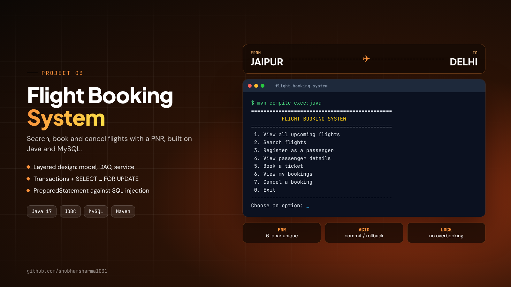
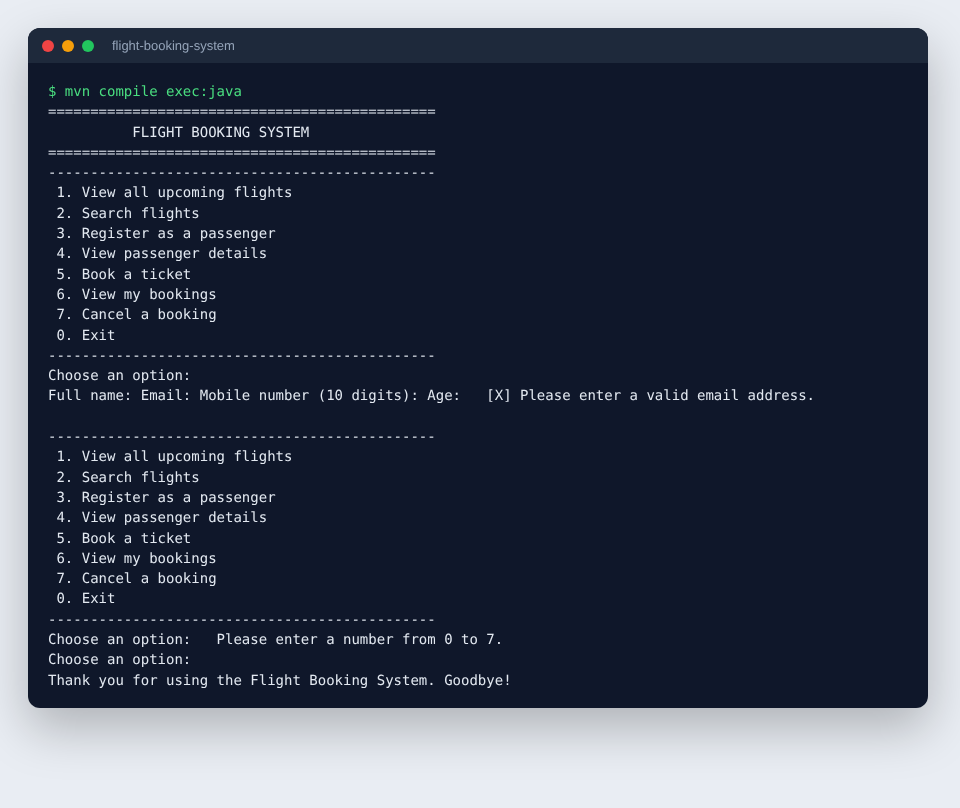

# Flight Booking System



A console-based flight booking application built with **Java** and **MySQL** using **JDBC**. Users can search flights, register as passengers, book tickets with a generated PNR, view their bookings and cancel them. Seat counts stay correct even when two people book at the same time, because bookings run inside database transactions with row locking.


## Features

- View all upcoming flights, or search by **source, destination and date**
- **Register passengers** with validation (name, email, 10-digit Indian mobile number, age)
- **Book 1–6 seats** on a flight and get a unique 6-character **PNR**
- View all bookings for a passenger
- **Cancel a booking** by PNR; seats are released back to the flight
- Business rules: cannot book a departed flight, cannot overbook, cannot cancel twice

## Demo

```
==============================================
          FLIGHT BOOKING SYSTEM
==============================================
 1. View all upcoming flights
 2. Search flights
 ...
Choose an option: 2

From (city): Jaipur
To (city): Delhi
Travel date YYYY-MM-DD (press Enter for any date):
Flight  Airline    From       To         Departure           Time     Seats         Fare
----------------------------------------------------------------------------------------
SW101   SkyWays    Jaipur     Delhi      16 Jan 2026, 06:30  1h05m      180    ₹3,499.00
1 flight(s) found.
```



## Design

```
Main (console menu)
  │
  ▼
BookingService        ← validation + business rules + transactions
  │
  ├── FlightDao       ← SQL for flights
  ├── PassengerDao    ← SQL for passengers
  └── BookingDao      ← SQL for bookings (JOIN with flights)
        │
        ▼
DatabaseConnection → MySQL (flight_booking)
```

| Layer | Responsibility |
|---|---|
| `model` | Data classes as Java **records**: `Flight`, `Passenger`, `Booking`, `BookingStatus` |
| `dao` | All SQL, written with **PreparedStatement** (prevents SQL injection) |
| `service` | Validation and rules; booking and cancelling use **transactions** (`commit` / `rollback`) |
| `util` | Console input that keeps asking until the input is valid |

### How double booking is prevented

When a booking starts, the flight row is read with `SELECT ... FOR UPDATE`. MySQL locks that row until the transaction ends, so a second booking for the same flight waits. The seat check, the booking insert and the seat update then happen as one unit: if anything fails, `rollback()` undoes all of it.

## Database

Three tables with primary keys, foreign keys, unique constraints and `CHECK` constraints:

- `flights`: route, times, total and available seats, fare
- `passengers`: unique email
- `bookings`: unique PNR, links passenger and flight, status `CONFIRMED` / `CANCELLED`

See [`sql/schema.sql`](sql/schema.sql). [`sql/seed.sql`](sql/seed.sql) adds 15 sample flights with dates relative to today, so there are always upcoming flights to book.

## How to run

**Requirements:** Java 17+, MySQL 8, Maven (or IntelliJ IDEA, which includes Maven).

1. **Create the database**

   ```bash
   mysql -u root -p < sql/schema.sql
   mysql -u root -p < sql/seed.sql
   ```

2. **Configure the connection**: copy `src/main/resources/db.properties.example` to `src/main/resources/db.properties` and set your MySQL password. (`db.properties` is in `.gitignore`, so your password is never committed.)

3. **Run**

   ```bash
   mvn compile exec:java
   ```

   Or in IntelliJ: **File → Open** the project folder, wait for Maven to load, then run `Main.java`.

## Project structure

```
flight-booking-system/
├── pom.xml
├── sql/
│   ├── schema.sql
│   └── seed.sql
└── src/main/
    ├── java/com/shubham/flightbooking/
    │   ├── Main.java
    │   ├── db/DatabaseConnection.java
    │   ├── model/   Flight, Passenger, Booking, BookingStatus
    │   ├── dao/     FlightDao, PassengerDao, BookingDao
    │   ├── service/ BookingService, BookingException
    │   └── util/    ConsoleInput
    └── resources/db.properties.example
```

## Possible improvements

- Seat selection (window/aisle) with a seat map
- Round-trip and multi-city search
- JUnit tests with an in-memory database
- A web front end with Spring Boot

## Author

**Shubham Sharma** · [LinkedIn](https://www.linkedin.com/in/shubham-sharma-27aa38268) · [Portfolio](https://shubhamsharma1031.netlify.app/)
